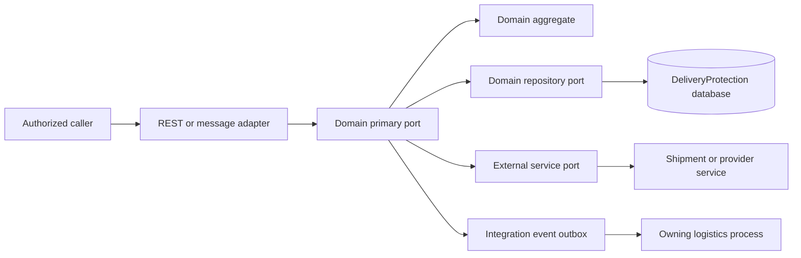

# DeliveryProtection redesign

## Purpose and boundaries

DeliveryProtection owns credentials that authorize or confirm a specific logistics action. It does not own shipment status, parcel routing, pickup point data, or the physical operation itself. ShipmentManagement, DeliveryOperation, and ReturningTrackManager remain the owners of those processes. A successful token redemption is evidence for the owning process to perform its state transition; it is not a direct shipment update in DeliveryProtection.

The module contains four distinct domains:

| Domain | Meaning | Issuer | Redemption context |
| --- | --- | --- | --- |
| `handovertoken` | Confirmation of delivery to the addressee or an authorized recipient | DeliveryProtection after an authorized handover request | One handover process, shipment, and recipient context |
| `deliverytoken` | Code for the addressee to **collect** a shipment at a parcel locker or staffed pickup point | Carrier or pickup provider; DeliveryProtection stores and controls its use | One shipment, provider, collection location, and channel (`LOCKER` or `POINT`) |
| `returntoken` | Authorization to hand a shipment back into the return flow | DeliveryProtection after a valid return request | One return operation and shipment |
| `pickuptoken` | Code for **sending** a parcel at a parcel locker or staffed drop-off point | Carrier or pickup provider; DeliveryProtection stores and controls its use | One shipment, provider, drop-off location, and channel (`LOCKER` or `POINT`) |

`PickupToken` is a code for the sender to **send** a parcel. `DeliveryToken` is a code for the addressee to **collect** it. `HandoverToken` confirms direct delivery to the addressee; it does not apply to collection at a point or locker. The existing `deliverytoken` code implements supplier delivery-data protection rather than this target role, so it needs migration.

## Target structure

Keep `DeliveryProtection` as the deployable service. Add `DeliveryProtectionApi` for stable internal contracts and keep `DeliveryProtectionCore` for implementation. Each of the four domains has its own `com.warehouse.<domain>` package with the local `domain`, `application`, `infrastructure`, and `configuration` layers. Do not create a shared token aggregate or a shared persistence table: the four actions have different owners, eligibility rules, and external integrations.

```text
DeliveryProtection/
  DeliveryProtectionApi/        internal contracts and integration-event payloads only
  DeliveryProtectionCore/
    com.warehouse.handovertoken/{domain,application,infrastructure,configuration}
    com.warehouse.deliverytoken/{domain,application,infrastructure,configuration}
    com.warehouse.returntoken/{domain,application,infrastructure,configuration}
    com.warehouse.pickuptoken/{domain,application,infrastructure,configuration}
```

Within each domain, the aggregate and its invariants belong in `domain.model`, commands and primary ports in `application.port.primary`, repository and external-system contracts in `application.port.secondary`, HTTP or message consumers in `infrastructure.adapter.primary`, and persistence/provider clients in `infrastructure.adapter.secondary`. Mappers stay in adapters. The application layer coordinates persistence, transactions, and publishing events after persistence. Domain code has no Spring, JPA, HTTP, or other domain's infrastructure imports.



## Domain contracts

### HandoverToken

- Issue for a concrete `ProcessId` and `ShipmentId` when DeliveryOperation reports that the shipment is ready for handover to the addressee. Existing handover requests can contain several tracking numbers and produce partial results, so token state is per shipment within the process.
- Verify the token only for that process and shipment. Atomic `confirm` consumes it once and records the confirmation time. It does not replace a recipient signature or name when supplier policy requires them. A repeated confirmation for the same process and shipment is idempotent; another process fails.
- Reissue revokes the previous active token. Cancellation of the recipient handover revokes it.
- Publish `HandoverConfirmed` after persistence so DeliveryOperation can complete delivery to the addressee through its existing shipment handover flow.

### DeliveryToken

- `register` accepts a collection code for a `ShipmentId`, provider, `PickupPointId` from the shipment's `deliveryPickupPointId`, channel (`LOCKER` or `POINT`), provider reference, and provider expiry. The provider issues the code when it controls locker or point access; local issuance is allowed only if the provider contract supports it.
- `present` gives the code only to the authorized addressee through a controlled channel. `confirmCollection` consumes it after an authenticated provider event confirms physical collection. Showing or entering the code alone does not mark the shipment delivered.
- A change of delivery pickup point, provider cancellation, or replacement of the collection code revokes the old token. One code cannot collect another shipment or be reused after confirmed collection. Publish `CollectionConfirmed` after persistence so ShipmentManagement can record collection.
- The current `DeliveryTokenService.signDelivery` instead takes parcel/delivery data and a supplier and returns `ProtectedDelivery` plus supplier signatures. Its production `DeliveryTokenMockAdapter` uses a constant protection token. Preserve that contract temporarily in a compatibility adapter; it is not the new DeliveryToken behavior.

### ReturnToken

- Issue for a concrete `ReturnId` and `ShipmentId` only after the return owner confirms eligibility. A repeated issue request for the same operation returns its current state rather than minting another active code.
- `verify` takes the return operation and shipment as well as the code; global existence of a code is insufficient. `redeem` atomically consumes it and publishes `ReturnAuthorized`. The return owner then advances the return process.
- Reissue revokes the previous active token. Cancellation of the return revokes it. Expired, revoked, locked, and consumed codes are invalid.
- The old bulk-signing response and `/return-tokens` routes need a compatibility adapter during migration.

### PickupToken

- `register` accepts a provider-issued sending code with `ShipmentId`, provider, `PickupPointId`, channel, provider reference, and provider expiry. A locally issued code is allowed only if a particular provider contract explicitly supports it.
- `present` returns the code to an authorized sender through a controlled channel. `confirmDropOff` accepts a provider-confirmed deposit event with an idempotency key; merely displaying or scanning the code does not prove that the parcel was deposited.
- Replacement of a provider code revokes the prior one. Provider cancellation, expiry, or a change of pickup location invalidates it. The code cannot be used for a different shipment or location.
- Publish `DropOffConfirmed` after recording provider confirmation. ShipmentManagement owns the shipment status change.

## Common invariants and security

- Identity is typed: reuse `ProcessId`, `ShipmentId`, and existing identifiers; add domain-specific identifiers only where the owning context has no suitable one. Avoid raw `Long` identifiers in domain contracts.
- Every verification is scoped to its operation and shipment. The code alone never identifies an operation. Each domain allows at most one active token for an operation or shipment-specific provider reference.
- Generated short codes use a cryptographically secure random generator. Store a keyed digest for verification, compare in constant time, limit failed attempts, and rate-limit the inbound endpoint. Persist only a token fingerprint in audit and integration events.
- PickupToken and DeliveryToken codes may need redisplay to the sender or addressee. Store their recoverable value encrypted, with the encryption key outside the database; use a digest for matching. Do not put codes in logs, URLs, Kafka messages, or routine read models.
- Expiry is evaluated using an injected `Clock` at use time. State transitions are `ISSUED -> CONSUMED`, `ISSUED -> REVOKED`, or `ISSUED -> LOCKED`; expiry does not require a scheduled database update. Provider confirmation for DeliveryToken and PickupToken is represented separately from local code presentation.
- Commands carry an idempotency key. Repository writes use a version column or a conditional update so simultaneous redemptions cannot both succeed. Issuance, redemption, and outbox insert run in one transaction.
- Caller authorization uses the existing JWT or device API-key mechanism and checks the actor's permission for the specific operation. Provider callbacks require an authenticated integration identity already supported by the platform. Public unauthenticated token verification is not part of this design.

## API and persistence

Expose one primary port per domain: `HandoverTokenPort`, `DeliveryTokenPort`, `ReturnTokenPort`, and `PickupTokenPort`. The new token flows accept typed commands and return explicit results (`Issued`, `Confirmed`, `Expired`, `Invalid`, `Locked`, `Revoked`) without leaking whether a guessed code belongs to another shipment. Keep the old supplier-protection contract only as a compatibility adapter. HTTP controllers belong in Core. `DeliveryProtectionApi` contains only contracts needed by other in-process modules or integration-event consumers, never entities or controllers.

Use one Liquibase-managed table per domain (`handover_tokens`, `delivery_tokens`, `return_tokens`, `pickup_tokens`). Store the operation id, shipment id, state, issue/expiry/consumption times, failed-attempt count, version, and audit metadata as applicable. Index the operation id and shipment id, and enforce one active token per operation with a database constraint or transactional locking. DeliveryToken and PickupToken additionally store provider, pickup point, channel, provider reference, encrypted code, and code digest. Do not edit the existing `return_tokens` changeset; migrate it with new changesets and preserve existing records until all callers have switched.

## Migration from the current service

1. Introduce `DeliveryProtectionApi`, the four domain packages/ports, their persistence and endpoints without removing the current `/return-tokens` contract. Wire all four packages into component, entity, repository, and configuration scans.
2. Integrate HandoverToken with DeliveryOperation's existing `DeliveryHandover` process and its per-shipment results. Integrate DeliveryToken with the delivery pickup-point plan and collection confirmation from the provider. Move the old supplier-protection behavior behind a compatibility adapter, and remove `DeliveryTokenMockAdapter` from production configuration. Move the existing delivery and return port interfaces out of `domain.port` into `application.port` as their callers migrate.
3. Route return issuance and validation through one authority. Today DeliveryProtection issues return tokens while ReturningTrackManager also owns return-token generation and validation; choose DeliveryProtection as the authority and make ReturningTrackManager consume its result through a secondary service port. Migrate existing active return tokens without extending their validity.
4. Migrate DeliveryOperation and other callers one at a time using compatibility adapters. Preserve response shapes during transition, then remove the old endpoints and tables in a later release after usage reaches zero.
5. Add unit tests for all four aggregates' expiry, reissue, wrong-context rejection, lockout, and single redemption; persistence tests for concurrent redemption and active-token uniqueness; contract tests for existing clients; and provider callback idempotency tests for DeliveryToken and PickupToken.

## Decisions required before implementation

The recipient confirmation policy for HandoverToken, return expiry, the providers and issuance contracts for DeliveryToken and PickupToken, and their callback contracts are business/integration inputs. Configure lifetime and attempt limits per domain instead of hard-coding them into aggregates.
