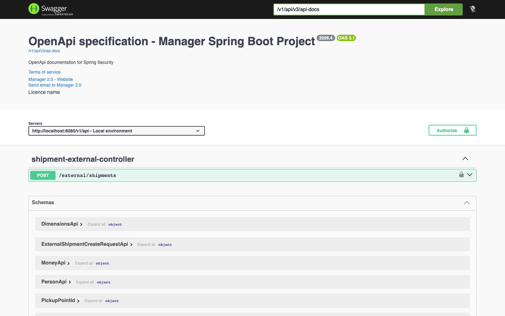
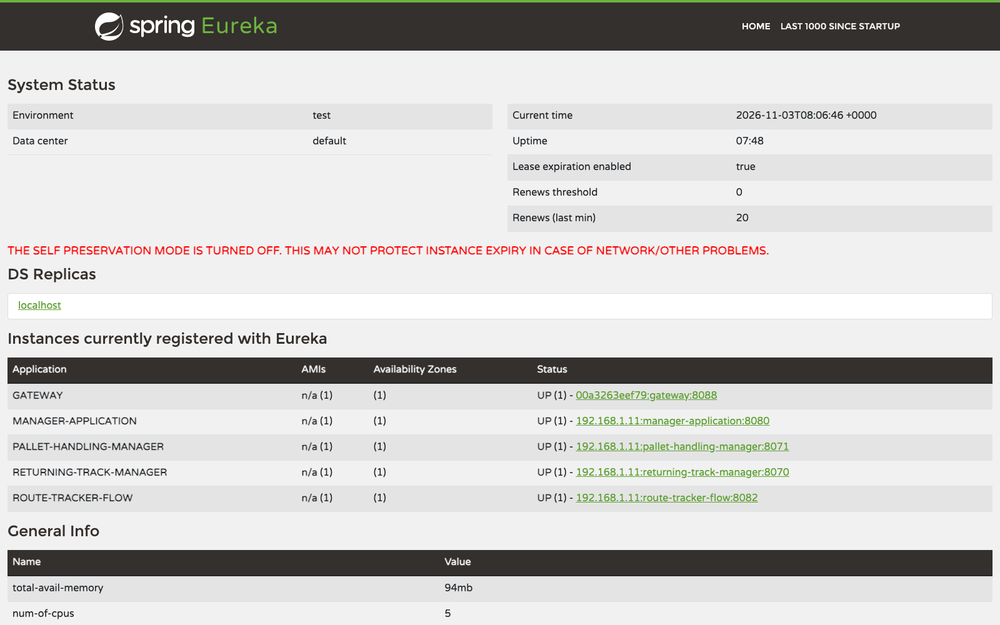
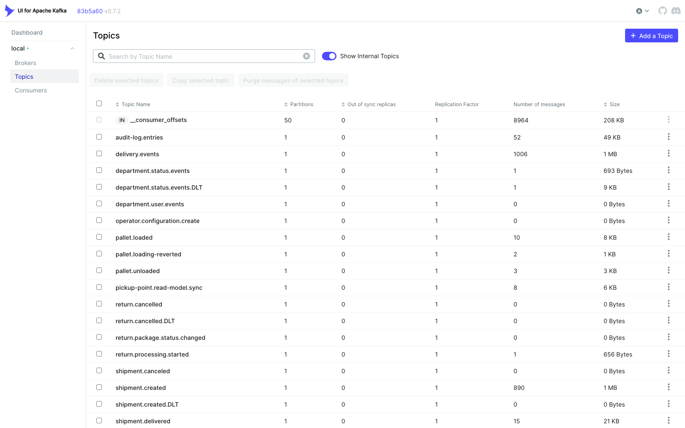

# Manager 2.0 Backend

[English](README.md) | [Polski](README.pl.md) | **Deutsch**

**Entwicklungsversion 2026.4 - 10. September 2026**

Manager 2.0 ist ein Java-21-/Spring-Boot-Backend für Lager- und Logistikprozesse.
Das Repository ist ein Maven-Projekt mit mehreren Modulen. Die Hauptanwendung ist
das Modul `Application`, das die Domänenmodule zu einer API unter `/v1/api`
zusammenführt.

## Über das Backend

Manager 2.0 steuert die tägliche Arbeit eines Paketlogistik-Betreibers. Das
Backend verwaltet den Lebenszyklus einer Sendung von der Erfassung über Sortierung,
Palettentransport und Zustellung bis zu Retouren und Annahmeverweigerungen und
bestimmt, welche Niederlassung eine Sendung zustellt und welchen Weg sie durch das
Zustellnetz nimmt. Außerdem verwaltet es die Organisation selbst: Betreiber,
Niederlassungen mit ihren Zustellgebieten und Lagerplänen, Abhol- und
Paketstationen, Benutzer, Rollen und gekoppelte Terminals. Kuriere und
Lagermitarbeiter scannen Pakete auf mobilen Terminals über einen SOAP-Endpunkt,
die Büromitarbeiter nutzen die React-GUI über REST.

Die Domänenmodule kommunizieren über Kafka-Ereignisse, sodass Lesemodelle,
Audit-Log, Prozessprotokolle und E-Mail-Benachrichtigungen ohne enge Kopplung
aktuell bleiben. Jede Anfrage läuft im Kontext genau eines Betreibers, wodurch die
Daten verschiedener Unternehmen getrennt bleiben. Über einen MCP-Server
können KI-Assistenten Sendungen, Routen, Zustellungen, Prozesse, Geräte, Niederlassungen,
Kuriere und Konfiguration abfragen und, mit Managerrechten, ändern.

## Screenshots

| | |
| --- | --- |
| [](docs/screenshots/swagger.png) | [](docs/screenshots/eureka.png) |
| **Swagger UI**: OpenAPI-Dokumentation unter `/v1/api/swagger-ui/index.html` | **Eureka**: Manager, Gateway und zugehörige Dienste, registriert auf Port `8761` |

[](docs/screenshots/kafka-topics.png)

**Kafka UI**: Topics der Domänenereignisse (Sendungen, Zustellungen, Paletten, Retouren, Audit-Log) mit ihren Dead-Letter-Topics, im Docker-Stack auf Port `8090` erreichbar.

## Technologie

- Java 21
- Maven-Build mit mehreren Modulen
- Spring Boot 3.5.5
- Spring Cloud 2025.0.3
- Spring Web, Security, Validation, Actuator und OpenFeign
- Spring Data JPA/JDBC, Liquibase und PostgreSQL
- Kafka für Domänenereignisse und die Synchronisierung des Sendungs-Lesemodells
- Service Discovery mit Eureka und ein schlanker Gateway-Dienst
- Lombok, MapStruct und springdoc OpenAPI

## Hauptmodule

| Modul | Zweck |
| --- | --- |
| `Application` | Spring-Boot-Hauptanwendung auf Port `8080`, API-Kontext `/v1/api`. |
| `Authorization` | Anmeldung, JWT-/Cookie-Authentifizierung, Refresh-Tokens, Kontext des aktuellen Benutzers/Betreibers und Berechtigungen. |
| `OrganisationStructure` | Betreiberverwaltung, Betreiberkonfiguration, Bereitstellung der Anfangsdaten eines Betreibers und Niederlassungen (Kennungen, Koordinaten und Synchronisierung des Lesemodells). |
| `ShipmentManagement` | Sendungen, Gefahrgut, Abhol- und Zustellarten, Zuordnung von Abholstationen, Retourenübersichten, Sendungsstatus, Notizen, Dokumentlinks und Tracking-Integrationen. |
| `PickupPointManagement` | Aggregat der Abholstation, Lebenszyklus, Adress-Geokodierung, betreiberbezogene Persistenz, aus Kafka projiziertes Suchmodell und REST-API. |
| `OrganizationChat` | Dauerhafte Direktunterhaltungen, Suche nach Benutzern der Organisation, WebSocket-Präsenz und Nachrichtenbenachrichtigungen. |
| `DeliveryOperation` | Abwicklung von Zustell-, Retouren- und Ablehnungsprozessen. |
| `LogisticsOrchestrator` | Koordinationsschicht für Logistikabläufe. |
| `ProcessHub` | Prozessprotokolle und Prozessdetails für die GUI. |
| `DepartmentMap` | Niederlassungspläne (`department_maps`, Elemente), Belegung von Lagerplätzen mit optimistischem Sperren, Palettenplatzierung, Reservierungen und Standortverlauf (`/department-maps`). |
| `Device` | Gerätekopplung, Geräteprüfung und Zugriffsprüfung für Terminals/Geräte. |
| `AuditLog` | Gemeinsames betreiberbezogenes Audit-Log (`/audit-log`): was getan wurde (Ressource, Aktion, geänderte Felder) und wer es getan hat (Benutzer, Niederlassung). Module übersetzen ihre Domänenereignisse in `AuditLogEntryIntegrationEvent`, veröffentlichen sie über den Kafka-Outbox (`audit-log.entries`), und `AuditLogKafkaEventListener` speichert sie idempotent nach Ereignis-ID. |
| `McpServer` | MCP-Server (`/v1/api/mcp`), über den KI-Assistenten Sendungen, Zustellungen, Niederlassungen, Kuriere und Konfiguration abfragen und ändern. |
| `SupplierServiceManagement` | Lieferanten, Pakettypen, Zustellgebiete, Fahrzeugdaten und Lieferantenaktualisierungen. |
| `GeocodingService` | Konfiguration des Geokodierungsanbieters und Geokodierungs-API. |
| `PathFinder` und `DestinationDetermination` | Routenplanung, Bestimmung der Zustellniederlassung, Adresskoordinaten und Gebietsberechnung. |
| `DocumentStorage` | Werkzeuge zur Barcode- und CSV-Erzeugung sowie gemeinsame betreiberbezogene Dokumentablage (`DocumentStorageApi` und `DocumentStorageImpl`). |
| `MessageProvider` und `MailService` | Nachrichteninfrastruktur; Kafka-gesteuerte E-Mail-Benachrichtigungen aus mehrsprachigen Datenbankvorlagen. |
| `Common` | Gemeinsame Value Objects, Enums, Exceptions, Repository-Hilfen, Betreiberkontext und Sicherheitswerkzeuge. |
| `Gateway` | Gateway-Dienst auf Port `8088`; leitet Anfragen an den Manager und zugehörige Dienste weiter. |
| `EurekaServer` | Eureka-Server auf Port `8761`. |
| `ArchitectureTest` und `E2E` | Module für Architektur- und End-to-End-Tests. |

Einige ältere oder dienstspezifische Verzeichnisse sind noch im Repository
vorhanden, gehören aber nicht zum aktiven Maven-Root-Reactor, z. B. `Terminal`,
`PaymentManagement`, `Properties` und einzelne `target`-Verzeichnisse.

## Lokale Konfiguration

Das Standardprofil ist `dev`.

Wichtige Standardwerte aus `Application/src/main/resources`:

- API-Port: `8080`
- API-Kontextpfad: `/v1/api`
- Datenbank: `jdbc:postgresql://localhost:5432/dev`
- Datenbankbenutzer/-passwort: `postgres` / `postgres`
- Liquibase-Changelog: `classpath:/changelog/db.changelog-master.xml`
- Eureka-URL: `http://localhost:8761/eureka/`
- Kafka-Bootstrap-Server: `localhost:9092`
- Erlaubter CORS-Ursprung der GUI: `http://localhost:3000`

Das PostgreSQL-Skript `docker/postgresql/init/01-create-databases.sql` legt die
Datenbanken `dev`, `rm` und `rt` an.

Häufig genutzte Umgebungsvariablen:

- `SPRING_PROFILES_ACTIVE`
- `SPRING_DATASOURCE_URL`
- `SPRING_DATASOURCE_USERNAME`
- `SPRING_DATASOURCE_PASSWORD`
- `SPRING_KAFKA_BOOTSTRAP_SERVERS`
- `MANAGER_KAFKA_PICKUP_POINT_READ_MODEL_SYNC_ENABLED`
- `PICKUP_POINT_READ_MODEL_SYNC_TOPIC`
- `PICKUP_POINT_READ_MODEL_SYNC_GROUP_ID`
- `RETURNING_SERVICE_URL`
- `RETURNING_SERVICE_ENDPOINT`
- `JWT_SECRET_KEY`
- `AUTH_CORS_ALLOWED_ORIGINS`
- `CREDENTIALS_ENCRYPTION_KEY`

### E-Mail-Benachrichtigungen

`MailService` empfängt Integrationsereignisse zu Sendungen aus Kafka in `MailKafkaListener`
(`shipment.created`, Statusänderungen aus `shipment.events`, `shipment.out-for-delivery`, `shipment.delivered`,
`shipment.reroute.requested`), bildet jedes Ereignis auf allgemeine `MailRequest`s ab (Vorlagenschlüssel, Empfänger,
Sprache, Variablen) und versendet sie per SMTP. Die Mailtexte stehen nicht im Code, sondern in der Tabelle
`mail_templates` (`template_key`, `locale`, `subject`, `body`), die Liquibase auf `pl`, `en` und `de` befüllt.
Vorlagen verwenden Platzhalter `{{variable}}` und optionale Abschnitte `{{#variable}}...{{/variable}}`.
Eine Anfrage ohne Vorlage wird übersprungen; eine neue Vorlagenzeile aktiviert also eine neue Benachrichtigung
(z. B. `shipment.status.prepared.recipient`). Die Sprache des Empfängers wird aus dem Ländercode der Partei
(`MAIL_COUNTRY_LOCALES`) bestimmt, mit Rückfall auf die Sprache und danach auf `MAIL_DEFAULT_LOCALE`.

Lokale Entwicklung: `docker compose -f docker.compose.yml up -d mailhog` startet MailHog (SMTP `localhost:1025`,
Weboberfläche http://localhost:8025), und das Profil `dev` schickt jede E-Mail dorthin, sodass nichts deinen Rechner
verlässt. Für einen echten SMTP-Server kopierst du `application-local.properties.example` nach
`application-local.properties` (von git ignoriert, vom Profil `dev` aus dem Arbeitsverzeichnis oder dessen
Elternverzeichnis importiert) und trägst die Postfachdaten ein. Umgebungsvariablen überschreiben beide Dateien.

- `MAIL_ENABLED` (standardmäßig `false`, im Profil `dev` `true`; bei `false` werden E-Mails nur protokolliert)
- `MAIL_HOST`, `MAIL_PORT`, `MAIL_USERNAME`, `MAIL_PASSWORD`, `MAIL_SMTP_AUTH`, `MAIL_SMTP_STARTTLS`, `MAIL_SMTP_SSL`
- `MAIL_FROM_ADDRESS`, `MAIL_FROM_NAME`
- `MAIL_DEFAULT_LOCALE`, `MAIL_UNMAPPED_COUNTRY_LOCALE`, `MAIL_COUNTRY_LOCALES`
- `MAIL_TRACKING_URL`, `MAIL_SHIPMENT_EDIT_URL`

## Bauen und Starten

Alle aktiven Maven-Module bauen:

```bash
mvn clean package
```

Die Haupt-API des Backends starten:

```bash
mvn -pl Application -am spring-boot:run
```

Eureka starten:

```bash
mvn -pl EurekaServer -am spring-boot:run
```

Das Gateway starten:

```bash
mvn -pl Gateway -am spring-boot:run
```

Tests ausführen:

```bash
mvn test
```

Tests eines einzelnen Moduls ausführen:

```bash
mvn -pl ShipmentManagement/ShipmentManagementImpl -am test
```

## Docker

Den Compose-Stack aus dem Wurzelverzeichnis des Repositorys starten:

```bash
docker compose -f docker.compose.yml up -d
```

Alle Dienste gemeinsam anhalten, Container und Datenbank-Volumes bleiben erhalten:

```bash
docker compose -f docker.compose.yml stop
```

Vorhandene Container startest du mit `docker compose -f docker.compose.yml start` erneut. Um die Container und
das Netzwerk des Stacks anzuhalten und zu entfernen, verwende `docker compose -f docker.compose.yml down`;
benannte Datenbank-Volumes bleiben erhalten, solange nicht ausdrücklich `--volumes` angegeben wird.

Der Stack ist in `docker.compose.yml` definiert. Der Projektname bleibt
`managerv2`, passend zu den vorhandenen Containern und der Docker-Desktop-Konfiguration.

Der Stack enthält PostgreSQL, MongoDB, ZooKeeper, Kafka, Kafka UI, MailHog (http://localhost:8025), Eureka,
Gateway, Software Configuration, Returning Manager und Route Tracker. Die
Hauptanwendung `Application` wird wie oben beschrieben separat gestartet.

Ältere Elasticsearch- und Kibana-Container können in Docker Desktop unter diesem
Projekt noch erscheinen, sind in dieser Compose-Konfiguration aber nicht mehr definiert.

Das Wurzel-`Dockerfile` und `Application/Dockerfile` bauen beide das Jar der
Hauptanwendung `Application` und stellen Port `8080` bereit.

```bash
docker build -t manager-v2-backend .
```

Separate Dockerfiles gibt es für:

- `Gateway` auf Port `8088`
- `EurekaServer` auf Port `8761`

## MCP-Server

`McpServer` stellt unter `/v1/api/mcp` einen zustandslosen MCP-Endpunkt bereit (Spring AI MCP Server, Streamable HTTP).
Anfragen werden mit einem API-Schlüssel des Benutzers authentifiziert, der als `Authorization: Bearer <key>` gesendet
wird; der Schlüssel wird mit `POST /v1/api/auth/me/api-key` erzeugt (mit `DELETE` widerrufen) und nur als HMAC-Hash
mit Ausstellungsdatum gespeichert. Schlüssel, die vor Einführung des Ausstellungsdatums erstellt wurden, sowie bei der
Registrierung automatisch vergebene Schlüssel werden nicht akzeptiert. Das Sperren eines Betreibers und das Widerrufen
von Sitzungen machen auch früher ausgestellte API-Schlüssel ungültig.

| Werkzeug | Parameter | Hinweise |
| --- | --- | --- |
| `whoami` | keine | Aktueller Benutzer, Rolle, Niederlassung und Betreiber. |
| `find_shipment` | `trackingNumber` | Status, Daten, maskierter Absender/Empfänger (Initialen, Ort, Postleitzahl) und die 10 neuesten Ereignisse. |
| `get_process` | `processId` (UUID) | Prozessstatus, Fehler, Gerät und Kommunikationsschritte ohne Anfrageinhalte. |
| `list_devices` | optional `status`, `departmentCode` | Bis zu 50 Geräte mit Zuordnungsmodus, Heartbeat und angemeldetem Bediener; erfordert MANAGER oder höher. |
| `get_shipment_route` | `trackingNumber` | Niederlassungen, die die Sendung vom Ursprung bis zum Ziel durchläuft, in Reihenfolge, mit Gesamtentfernung in km. |
| `list_departments` | optional `status`, `type` | Bis zu 100 Niederlassungen mit Code, Typ und Status. |
| `get_department` | `departmentCode` | Adresse und Koordinaten der Niederlassung. |
| `list_deliveries` | optional `departmentCode`, `courierCode`, `limit` | Neueste Zustellungen (standardmäßig 25, höchstens 100) mit Route, Kurier, Bedingungen und Schritten. |
| `get_delivery` | `deliveryId` oder `trackingNumber` | Eine Zustellung mit allen Schritten. |
| `list_couriers` | keine | Kuriere der eigenen Niederlassung; erfordert MANAGER oder höher. |
| `get_configuration` | `section` | Ein Abschnitt der Betreiberkonfiguration: `SHIPMENT`, `DEPARTMENTS`, `FLEET`, `COMMUNICATION`, `REGIONAL`, `SORTING` oder `PICKUP_POINTS`. |

Werkzeuge, die Daten ändern, erfordern MANAGER oder höher (`change_department_status` erfordert ADMIN). Weggelassene
optionale Felder behalten ihre aktuellen Werte.

| Werkzeug | Parameter | Hinweise |
| --- | --- | --- |
| `assign_delivery_courier` / `unassign_delivery_courier` | `deliveryId`, `courierCode`, optional `vehicleId` | Weist einer Zustellung einen Kurier zu oder entfernt ihn. |
| `change_delivery_route` | `deliveryId`, optional Ursprungs- und Ziel-Niederlassung, Abholart und Abholpunkte | Ändert die Route der Zustellung. |
| `change_delivery_conditions` | `deliveryId`, optional `method`, `signatureRequired`, `instructions`, `plannedAt` | Ändert die Zustellbedingungen. |
| `comment_delivery_step` / `correct_delivery_step_status` | `deliveryId`, `stepNumber`, `comment` oder `deliveryStatus` | Kommentiert einen Schritt oder korrigiert seinen Status. |
| `cancel_delivery` | `deliveryId` | Storniert eine Zustellung. |
| `create_shipment` | Absender, Empfänger, Maße (cm), Gewicht (kg), Preis, optionale Servicefelder | Legt eine Sendung an und gibt die Sendungsnummer zurück. |
| `change_shipment_party` | `trackingNumber`, `party` (`SENDER`/`RECIPIENT`), zu ändernde Felder | Ändert Absender- oder Empfängerdaten. |
| `change_department_address`, `change_department_type`, `change_department_email`, `change_department_status`, `set_department_active` | `departmentCode` und der neue Wert | Bearbeiten einer Niederlassung. |
| `create_courier` | `firstName`, `lastName`, `telephoneNumber`, `email`, optional `departmentCode`, `courierCode` | Legt einen Kurier und sein Benutzerkonto an. |
| `update_courier` / `set_courier_active` | `courierCode` und zu ändernde Felder / `active` | Bearbeiten, Aktivieren oder Deaktivieren eines Kuriers. |
| `update_configuration` | `section`, `changes` (JSON-Objekt) | Ändert nur die angegebenen Felder eines Konfigurationsabschnitts; unbekannte Felder werden abgelehnt. |

Alle Werkzeuge laufen im Betreiberkontext des Schlüsselinhabers. Den Endpunkt deaktivierst
du mit `MCP_SERVER_ENABLED=false`, nur die ändernden Werkzeuge mit `MCP_WRITE_ENABLED=false`. Beispiel für Claude Code:

```bash
claude mcp add --transport http manager https://manager.example.com/v1/api/mcp --header "Authorization: Bearer <api-key>"
```

## API und Dokumentation

Retourenoperationen stellt `ReturnPackageController` unter `/v1/api/returns/packages` bereit.
Das Anlegen erwartet eine Sendungs-ID; Bearbeiten (`PUT /{returnId}/process`), Abschließen
(`PUT /{returnId}/complete`) und Stornieren (`DELETE /{returnId}`) verwenden die ID des Retourenpakets.
Derselbe Controller liefert die Retourendetails und die seitenweise Liste der Niederlassung. Der
Retourenkontext ruft für Sendungsänderungen `ShipmentApiService` auf; Sendungsübersichten lesen
Retourendetails über `ReturningApiService`.

RTM veröffentlicht `return.cancelled` über seinen transaktionalen Outbox. Der Manager verarbeitet das
Ereignis im Retourenkontext, setzt die ursprüngliche Sendung auf `DELIVERY` zurück und storniert die
zugehörige Retourensendung. Das Manager-Changeset `return_processing_state` speichert endgültige
Stornomarkierungen, damit doppelte oder verspätete Verarbeitungsereignisse eine Stornierung nicht
rückgängig machen. Eine Schemaänderung in RTM ist nicht nötig.

Die Sendungssuche nutzt `ShipmentQueryPort` über den bestehenden Endpunkt `/v1/api/shipments/read-model/search`.

`ReturnConsumedEventTransactionTest` benötigt eine isolierte PostgreSQL-Datenbank. Aktiviere ihn mit
`RETURN_TEST_POSTGRES=true` und setze `RETURN_TEST_JDBC_URL`, `RETURN_TEST_JDBC_USER` und
`RETURN_TEST_JDBC_PASSWORD`. Der Test legt ein eigenes Testschema an und entfernt es wieder.

- API-Präfix zur Laufzeit: `/v1/api`
- Actuator-Health-Endpunkt: `/v1/api/actuator/health`
- OpenAPI wird in `Application/src/main/java/com/warehouse/configuration/OpenApiConfiguration.java` konfiguriert
- Release Notes werden in `CHANGELOG.md` gepflegt
- Hinweise zum InPost-Tracking stehen in `docs/inpost-global-tracking.md`
- Die Writerside-Dokumentationsquellen liegen in `Writerside`
