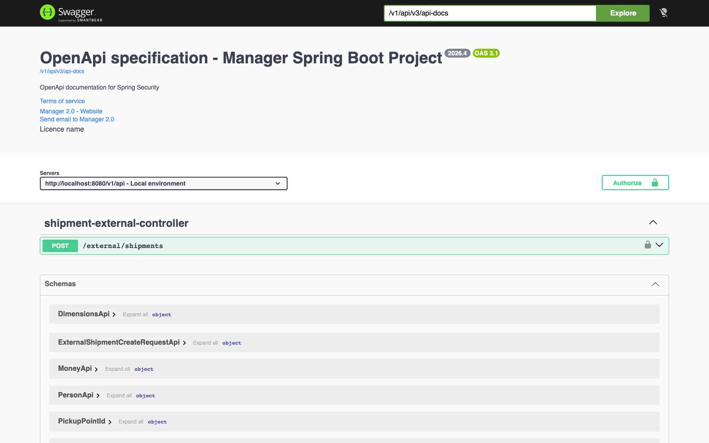
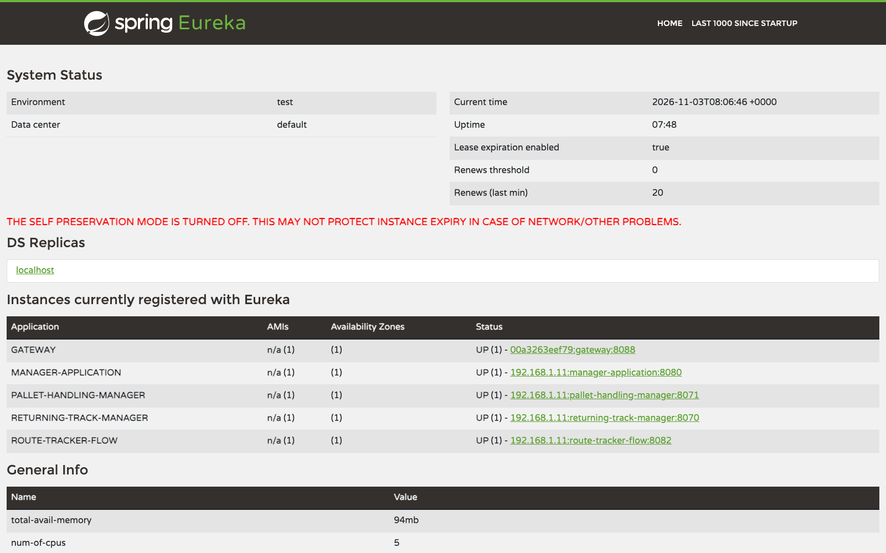
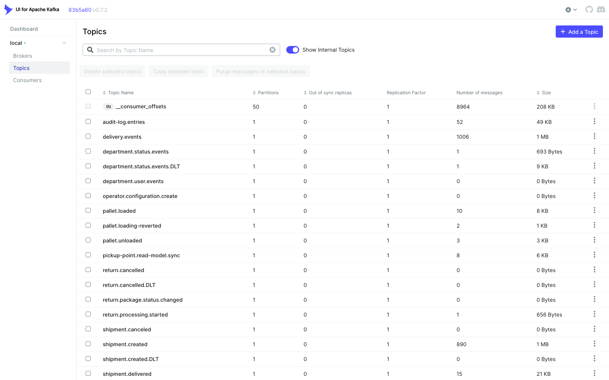

# Manager 2.0 Backend

[English](README.md) | **Polski** | [Deutsch](README.de.md)

**Wersja rozwojowa 2026.4 - 10 września 2026**

Manager 2.0 to backend w Java 21 / Spring Boot do obsługi operacji magazynowych
i logistycznych. Repozytorium jest wielomodułowym projektem Maven. Główną aplikacją
jest moduł `Application`, który łączy moduły domenowe w jedno API dostępne pod
`/v1/api`.

## O backendzie

Manager 2.0 obsługuje codzienną pracę operatora logistyki paczkowej. Backend
prowadzi cykl życia przesyłki od rejestracji przez sortowanie, transport na
paletach i doręczenie aż po zwroty i odmowy, a także ustala, który oddział doręcza
przesyłkę i jaką trasą przechodzi ona przez sieć doręczeń. Zarządza też samą
organizacją: operatorami, oddziałami wraz z obszarami doręczeń i planami magazynu,
punktami odbioru i paczkomatami, użytkownikami, rolami i sparowanymi terminalami.
Kurierzy i magazynierzy skanują paczki na terminalach mobilnych przez endpoint
SOAP, a pracownicy biura korzystają z GUI w React przez REST.

Moduły domenowe komunikują się zdarzeniami Kafka, więc modele odczytu, dziennik
audytu, logi procesów i powiadomienia e-mail są aktualne bez ścisłego powiązania
modułów. Każde żądanie działa w kontekście jednego operatora, co oddziela dane
różnych firm. Serwer MCP pozwala asystentom AI wyszukiwać przesyłki, trasy, dostawy,
procesy, urządzenia, oddziały, kurierów i konfigurację, a kierownikom także wprowadzać zmiany.

## Zrzuty ekranu

| | |
| --- | --- |
| [](docs/screenshots/swagger.png) | [](docs/screenshots/eureka.png) |
| **Swagger UI**: dokumentacja OpenAPI pod `/v1/api/swagger-ui/index.html` | **Eureka**: Manager, Gateway i powiązane serwisy zarejestrowane na porcie `8761` |

[](docs/screenshots/kafka-topics.png)

**Kafka UI**: tematy zdarzeń domenowych (przesyłki, doręczenia, palety, zwroty, dziennik audytu) wraz z tematami DLT, dostępne na porcie `8090` w stosie Docker.

## Technologie

- Java 21
- Wielomodułowy build Maven
- Spring Boot 3.5.5
- Spring Cloud 2025.0.3
- Spring Web, Security, Validation, Actuator i OpenFeign
- Spring Data JPA/JDBC, Liquibase i PostgreSQL
- Kafka do zdarzeń domenowych i synchronizacji modelu odczytu przesyłek
- Wykrywanie serwisów Eureka i lekki serwis Gateway
- Lombok, MapStruct i springdoc OpenAPI

## Główne moduły

| Moduł | Przeznaczenie |
| --- | --- |
| `Application` | Główna aplikacja Spring Boot na porcie `8080`, kontekst API `/v1/api`. |
| `Authorization` | Logowanie, uwierzytelnianie JWT/cookie, tokeny odświeżania, kontekst bieżącego użytkownika/operatora i uprawnienia. |
| `OrganisationStructure` | Zarządzanie operatorami, konfiguracja operatora, przygotowanie początkowych danych operatora oraz oddziały (identyfikatory, współrzędne i synchronizacja modelu odczytu). |
| `ShipmentManagement` | Przesyłki, towary niebezpieczne, sposoby nadania i doręczenia, przypisanie punktu odbioru, podsumowania zwrotów, status przesyłki, notatki, linki do dokumentów i integracje śledzenia. |
| `PickupPointManagement` | Agregat punktu odbioru, cykl życia, geokodowanie adresu, zapis w zakresie operatora, model wyszukiwania projektowany z Kafki i REST API. |
| `OrganizationChat` | Trwałe rozmowy bezpośrednie, wyszukiwanie użytkowników organizacji, obecność przez WebSocket i powiadomienia o wiadomościach. |
| `DeliveryOperation` | Obsługa procesów doręczenia, zwrotu i odmowy. |
| `LogisticsOrchestrator` | Warstwa koordynująca przepływy logistyczne. |
| `ProcessHub` | Logi procesów i szczegóły procesów używane przez GUI. |
| `DepartmentMap` | Plany oddziałów (`department_maps`, elementy), zajętość miejsc składowania z blokadą optymistyczną, rozmieszczenie palet, rezerwacje i historia lokalizacji (`/department-maps`). |
| `Device` | Parowanie urządzeń, weryfikacja urządzeń i walidacja dostępu terminali/urządzeń. |
| `AuditLog` | Wspólny dziennik audytu w zakresie operatora (`/audit-log`): co zrobiono (zasób, akcja, zmienione pola) i kto to zrobił (użytkownik, oddział). Moduły zamieniają swoje zdarzenia domenowe na `AuditLogEntryIntegrationEvent`, publikują je przez outbox Kafki (`audit-log.entries`), a `AuditLogKafkaEventListener` zapisuje je idempotentnie według ID zdarzenia. |
| `McpServer` | Serwer MCP (`/v1/api/mcp`), przez który asystenci AI wyszukują i zmieniają przesyłki, dostawy, oddziały, kurierów i konfigurację. |
| `SupplierServiceManagement` | Dostawcy, typy paczek, obszary doręczeń, dane pojazdów i aktualizacje dostawców. |
| `GeocodingService` | Konfiguracja dostawcy geokodowania i API geokodowania. |
| `PathFinder` i `DestinationDetermination` | Wyznaczanie tras, ustalanie oddziału doręczającego, współrzędne adresów i obliczenia obszarów. |
| `DocumentStorage` | Narzędzia do generowania kodów kreskowych i CSV oraz wspólne przechowywanie dokumentów w zakresie operatora (`DocumentStorageApi` i `DocumentStorageImpl`). |
| `MessageProvider` i `MailService` | Infrastruktura wiadomości; powiadomienia e-mail sterowane Kafką, renderowane z wielojęzycznych szablonów w bazie danych. |
| `Common` | Wspólne obiekty wartości, enumy, wyjątki, pomocniki repozytoriów, kontekst operatora i narzędzia bezpieczeństwa. |
| `Gateway` | Serwis Gateway na porcie `8088`; kieruje żądania do managera i powiązanych serwisów. |
| `EurekaServer` | Serwer Eureka na porcie `8761`. |
| `ArchitectureTest` i `E2E` | Moduły testów architektury i testów end-to-end. |

Niektóre starsze lub specyficzne dla serwisów katalogi nadal są w repozytorium,
ale nie należą do aktywnego głównego reaktora Maven, np. `Terminal`,
`PaymentManagement`, `Properties` i wybrane katalogi `target`.

## Konfiguracja lokalna

Domyślny profil to `dev`.

Najważniejsze wartości domyślne z `Application/src/main/resources`:

- Port API: `8080`
- Ścieżka kontekstu API: `/v1/api`
- Baza danych: `jdbc:postgresql://localhost:5432/dev`
- Użytkownik/hasło bazy: `postgres` / `postgres`
- Changelog Liquibase: `classpath:/changelog/db.changelog-master.xml`
- Adres Eureka: `http://localhost:8761/eureka/`
- Serwery Kafka: `localhost:9092`
- Dozwolony origin CORS dla GUI: `http://localhost:3000`

Skrypt PostgreSQL `docker/postgresql/init/01-create-databases.sql` tworzy bazy
`dev`, `rm` i `rt`.

Często używane zmienne środowiskowe:

- `SPRING_PROFILES_ACTIVE`
- `SPRING_DATASOURCE_URL`
- `SPRING_DATASOURCE_USERNAME`
- `SPRING_DATASOURCE_PASSWORD`
- `SPRING_KAFKA_BOOTSTRAP_SERVERS`
- `MANAGER_KAFKA_PICKUP_POINT_READ_MODEL_SYNC_ENABLED`
- `PICKUP_POINT_READ_MODEL_SYNC_TOPIC`
- `PICKUP_POINT_READ_MODEL_SYNC_GROUP_ID`
- `RETURNING_SERVICE_URL`
- `RETURNING_SERVICE_ENDPOINT`
- `JWT_SECRET_KEY`
- `AUTH_CORS_ALLOWED_ORIGINS`
- `CREDENTIALS_ENCRYPTION_KEY`

### Powiadomienia e-mail

`MailService` odbiera zdarzenia integracyjne przesyłek z Kafki w `MailKafkaListener`
(`shipment.created`, zmiany statusu z `shipment.events`, `shipment.out-for-delivery`, `shipment.delivered`,
`shipment.reroute.requested`), mapuje każde zdarzenie na ogólne `MailRequest` (klucz szablonu, odbiorca, język,
zmienne) i wysyła je przez SMTP. Treści maili nie są w kodzie: znajdują się w tabeli `mail_templates`
(`template_key`, `locale`, `subject`, `body`) wypełnianej przez Liquibase w językach `pl`, `en` i `de`.
Szablony używają znaczników `{{variable}}` i opcjonalnych sekcji `{{#variable}}...{{/variable}}`.
Żądanie bez szablonu jest pomijane, więc dodanie wiersza szablonu włącza nowe powiadomienie
(np. `shipment.status.prepared.recipient`). Język odbiorcy ustalany jest na podstawie kodu kraju
strony (`MAIL_COUNTRY_LOCALES`), z przejściem na język, a potem na `MAIL_DEFAULT_LOCALE`.

Praca lokalna: `docker compose -f docker.compose.yml up -d mailhog` uruchamia MailHog (SMTP `localhost:1025`,
interfejs WWW http://localhost:8025), a profil `dev` wysyła tam każdego maila, więc nic nie opuszcza Twojego komputera.
Aby użyć prawdziwego serwera SMTP, skopiuj `application-local.properties.example` do `application-local.properties`
(ignorowany przez git, importowany przez profil `dev` z katalogu roboczego lub nadrzędnego) i uzupełnij dane
skrzynki. Zmienne środowiskowe nadpisują oba pliki.

- `MAIL_ENABLED` (domyślnie `false`, `true` w profilu `dev`; przy `false` maile są tylko logowane)
- `MAIL_HOST`, `MAIL_PORT`, `MAIL_USERNAME`, `MAIL_PASSWORD`, `MAIL_SMTP_AUTH`, `MAIL_SMTP_STARTTLS`, `MAIL_SMTP_SSL`
- `MAIL_FROM_ADDRESS`, `MAIL_FROM_NAME`
- `MAIL_DEFAULT_LOCALE`, `MAIL_UNMAPPED_COUNTRY_LOCALE`, `MAIL_COUNTRY_LOCALES`
- `MAIL_TRACKING_URL`, `MAIL_SHIPMENT_EDIT_URL`

## Budowanie i uruchamianie

Zbudowanie wszystkich aktywnych modułów Maven:

```bash
mvn clean package
```

Uruchomienie głównego API backendu:

```bash
mvn -pl Application -am spring-boot:run
```

Uruchomienie Eureka:

```bash
mvn -pl EurekaServer -am spring-boot:run
```

Uruchomienie Gateway:

```bash
mvn -pl Gateway -am spring-boot:run
```

Uruchomienie testów:

```bash
mvn test
```

Uruchomienie testów jednego modułu:

```bash
mvn -pl ShipmentManagement/ShipmentManagementImpl -am test
```

## Docker

Uruchomienie stosu Compose z katalogu głównego repozytorium:

```bash
docker compose -f docker.compose.yml up -d
```

Zatrzymanie wszystkich serwisów z zachowaniem kontenerów i wolumenów baz danych:

```bash
docker compose -f docker.compose.yml stop
```

Istniejące kontenery uruchomisz ponownie przez `docker compose -f docker.compose.yml start`. Aby zatrzymać
i usunąć kontenery oraz sieć stosu, użyj `docker compose -f docker.compose.yml down`; nazwane wolumeny
baz danych zostają, chyba że jawnie podasz `--volumes`.

Stos jest zdefiniowany w `docker.compose.yml`. Nazwa projektu pozostaje
`managerv2`, zgodnie z istniejącymi kontenerami i konfiguracją Docker Desktop.

Stos zawiera PostgreSQL, MongoDB, ZooKeeper, Kafkę, Kafka UI, MailHog (http://localhost:8025), Eureka,
Gateway, Software Configuration, Returning Manager i Route Tracker. Główną
aplikację `Application` uruchamia się osobno według powyższych instrukcji.

Starsze kontenery Elasticsearch i Kibana mogą nadal być widoczne w Docker Desktop
w tym projekcie, ale nie są już zdefiniowane w tej konfiguracji Compose.

Główny `Dockerfile` i `Application/Dockerfile` budują jar głównej aplikacji
`Application` i wystawiają port `8080`.

```bash
docker build -t manager-v2-backend .
```

Osobne pliki Dockerfile są dostępne dla:

- `Gateway` na porcie `8088`
- `EurekaServer` na porcie `8761`

## Serwer MCP

`McpServer` wystawia bezstanowy endpoint MCP (Spring AI MCP Server, streamable HTTP) pod `/v1/api/mcp`.
Żądania są uwierzytelniane kluczem API użytkownika wysyłanym jako `Authorization: Bearer <key>`; klucz generuje
się przez `POST /v1/api/auth/me/api-key` (unieważnia przez `DELETE`) i jest przechowywany wyłącznie jako skrót HMAC
wraz z datą wydania. Klucze utworzone przed wprowadzeniem daty wydania oraz klucze przypisywane automatycznie przy
rejestracji nie są akceptowane. Zablokowanie operatora i unieważnienie sesji unieważniają też wcześniej wydane klucze API.

| Narzędzie | Parametry | Uwagi |
| --- | --- | --- |
| `whoami` | brak | Bieżący użytkownik, rola, oddział i operator. |
| `find_shipment` | `trackingNumber` | Status, daty, zamaskowany nadawca/odbiorca (inicjały, miasto, kod pocztowy) i 10 najnowszych zdarzeń. |
| `get_process` | `processId` (UUID) | Status procesu, błąd, urządzenie i kroki komunikacji bez treści żądań. |
| `list_devices` | opcjonalnie `status`, `departmentCode` | Do 50 urządzeń z trybem przypisania, heartbeatem i zalogowanym operatorem; wymaga roli MANAGER lub wyższej. |
| `get_shipment_route` | `trackingNumber` | Oddziały, przez które przesyłka przechodzi od nadania do doręczenia, w kolejności, z łączną odległością w km. |
| `list_departments` | opcjonalnie `status`, `type` | Do 100 oddziałów z kodem, typem i statusem. |
| `get_department` | `departmentCode` | Adres i współrzędne oddziału. |
| `list_deliveries` | opcjonalnie `departmentCode`, `courierCode`, `limit` | Najnowsze dostawy (domyślnie 25, najwyżej 100) z trasą, kurierem, warunkami i krokami. |
| `get_delivery` | `deliveryId` lub `trackingNumber` | Jedna dostawa ze wszystkimi krokami. |
| `list_couriers` | brak | Kurierzy oddziału użytkownika; wymaga roli MANAGER lub wyższej. |
| `get_configuration` | `section` | Jedna sekcja konfiguracji operatora: `SHIPMENT`, `DEPARTMENTS`, `FLEET`, `COMMUNICATION`, `REGIONAL`, `SORTING` lub `PICKUP_POINTS`. |

Narzędzia zmieniające dane wymagają roli MANAGER lub wyższej (`change_department_status` wymaga ADMIN). Pominięte
pola opcjonalne zachowują obecne wartości.

| Narzędzie | Parametry | Uwagi |
| --- | --- | --- |
| `assign_delivery_courier` / `unassign_delivery_courier` | `deliveryId`, `courierCode`, opcjonalnie `vehicleId` | Przypisuje lub odpina kuriera dostawy. |
| `change_delivery_route` | `deliveryId`, opcjonalnie kody oddziałów nadania i doręczenia, sposób odbioru i punkty odbioru | Zmienia trasę dostawy. |
| `change_delivery_conditions` | `deliveryId`, opcjonalnie `method`, `signatureRequired`, `instructions`, `plannedAt` | Zmienia warunki doręczenia. |
| `comment_delivery_step` / `correct_delivery_step_status` | `deliveryId`, `stepNumber`, `comment` lub `deliveryStatus` | Komentuje krok lub poprawia jego status. |
| `cancel_delivery` | `deliveryId` | Anuluje dostawę. |
| `create_shipment` | nadawca, odbiorca, wymiary (cm), waga (kg), cena, opcjonalne pola usługi | Tworzy przesyłkę i zwraca jej numer. |
| `change_shipment_party` | `trackingNumber`, `party` (`SENDER`/`RECIPIENT`), pola do zmiany | Zmienia dane nadawcy lub odbiorcy. |
| `change_department_address`, `change_department_type`, `change_department_email`, `change_department_status`, `set_department_active` | `departmentCode` i nowa wartość | Edycja oddziału. |
| `create_courier` | `firstName`, `lastName`, `telephoneNumber`, `email`, opcjonalnie `departmentCode`, `courierCode` | Dodaje kuriera i jego konto użytkownika. |
| `update_courier` / `set_courier_active` | `courierCode` i pola do zmiany / `active` | Edycja, aktywacja lub dezaktywacja kuriera. |
| `update_configuration` | `section`, `changes` (obiekt JSON) | Zmienia tylko podane pola sekcji konfiguracji; nieznane pola są odrzucane. |

Wszystkie narzędzia działają w kontekście operatora właściciela klucza API. Endpoint wyłączysz
przez `MCP_SERVER_ENABLED=false`, a same narzędzia zmieniające dane przez `MCP_WRITE_ENABLED=false`. Przykład dla Claude Code:

```bash
claude mcp add --transport http manager https://manager.example.com/v1/api/mcp --header "Authorization: Bearer <api-key>"
```

## API i dokumentacja

Operacje zwrotów udostępnia `ReturnPackageController` pod `/v1/api/returns/packages`.
Utworzenie przyjmuje ID przesyłki; przetwarzanie (`PUT /{returnId}/process`), zakończenie
(`PUT /{returnId}/complete`) i anulowanie (`DELETE /{returnId}`) używają ID paczki zwrotnej.
Ten sam kontroler zwraca szczegóły zwrotu i stronicowaną listę dla oddziału. Kontekst zwrotów
wywołuje `ShipmentApiService` przy zmianach przesyłki; podsumowania przesyłek czytają szczegóły
zwrotu przez `ReturningApiService`.

RTM publikuje `return.cancelled` przez swój transakcyjny outbox. Manager obsługuje je w kontekście
zwrotów, przywraca pierwotną przesyłkę do `DELIVERY` i anuluje powiązaną przesyłkę zwrotną. Changeset
`return_processing_state` w Managerze zapisuje końcowe znaczniki anulowania, dzięki czemu zduplikowane
lub opóźnione zdarzenia przetwarzania nie cofną anulowania. Zmiana schematu RTM nie jest potrzebna.

Wyszukiwanie przesyłek korzysta z `ShipmentQueryPort` przez istniejący endpoint `/v1/api/shipments/read-model/search`.

`ReturnConsumedEventTransactionTest` wymaga odizolowanej bazy PostgreSQL. Włączysz go przez
`RETURN_TEST_POSTGRES=true` i ustawienie `RETURN_TEST_JDBC_URL`, `RETURN_TEST_JDBC_USER` oraz
`RETURN_TEST_JDBC_PASSWORD`. Test tworzy i usuwa własny schemat testowy.

- Prefiks API w runtime: `/v1/api`
- Endpoint zdrowia Actuatora: `/v1/api/actuator/health`
- OpenAPI konfiguruje `Application/src/main/java/com/warehouse/configuration/OpenApiConfiguration.java`
- Informacje o wydaniach są prowadzone w `CHANGELOG.md`
- Notatki o śledzeniu InPost są w `docs/inpost-global-tracking.md`
- Źródła dokumentacji Writerside są w `Writerside`
